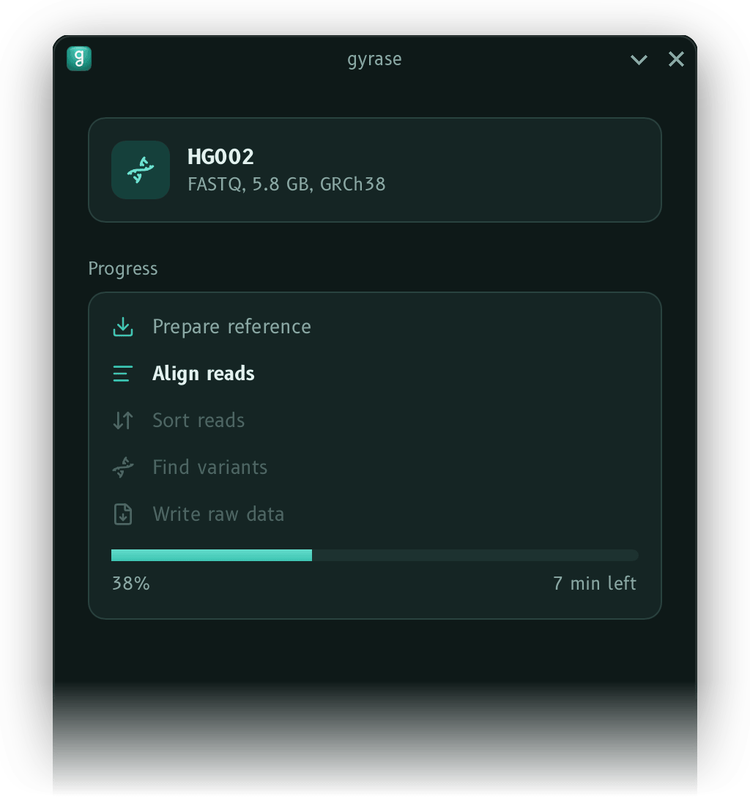

#  gyrase

Turn whole-genome DNA files into a VCF and raw genotype files for DNA match and ancestry sites.

<p align="center"></p>

## What it does

gyrase is an all-in-one tool. You do not need [ samtools](https://github.com/samtools/samtools), [ bcftools](https://github.com/samtools/bcftools), a separate aligner or [ WGS Extract](https://wgse.bio/).

Inputs and outputs:

- FASTQ: aligns reads to GRCh38 and writes a BAM file, a VCF file and raw genotype files. FASTQ files need a PC with 16 GB of RAM.
- SAM, BAM or CRAM: writes a VCF file. For GRCh37 and GRCh38, gyrase also writes raw genotype files.
- VCF, gVCF or BCF (GRCh37 or GRCh38): writes raw genotype files.

gyrase writes raw genotype files for [ 23andMe](https://www.23andme.com), [ AncestryDNA](https://www.ancestry.com/dna), [ FTDNA](https://www.familytreedna.com), [ MyHeritage](https://www.myheritage.com/dna) and [ LivingDNA](https://livingdna.com).

> [!NOTE]
> Raw genotype files can contain data that looks like medical results. They are not for medical use.

## Download and use

<a href="https://github.com/Z1xus/gyrase/releases/latest/download/gyrase-windows-x86_64.zip"><picture><source media="(prefers-color-scheme: dark)" srcset="https://www.shieldcn.dev/badge/Windows.svg?variant=default&amp;size=sm&amp;mode=dark"></picture></a> <a href="https://github.com/Z1xus/gyrase/releases/latest/download/gyrase-windows-arm64.zip"><picture><source media="(prefers-color-scheme: dark)" srcset="https://www.shieldcn.dev/badge/Windows%20%28ARM%29.svg?variant=default&amp;size=sm&amp;mode=dark"></picture></a> <a href="https://github.com/Z1xus/gyrase/releases/latest/download/gyrase-macos-arm64.tar.gz"><picture><source media="(prefers-color-scheme: dark)" srcset="https://www.shieldcn.dev/badge/macOS%20%28Apple%20Silicon%29.svg?variant=default&amp;size=sm&amp;mode=dark"></picture></a> <a href="https://github.com/Z1xus/gyrase/releases/latest/download/gyrase-macos-x86_64.tar.gz"><picture><source media="(prefers-color-scheme: dark)" srcset="https://www.shieldcn.dev/badge/macOS%20%28Intel%29.svg?variant=default&amp;size=sm&amp;mode=dark"></picture></a> <a href="https://github.com/Z1xus/gyrase/releases/latest/download/gyrase-linux-x86_64.tar.gz"><picture><source media="(prefers-color-scheme: dark)" srcset="https://www.shieldcn.dev/badge/Linux.svg?variant=default&amp;size=sm&amp;mode=dark"></picture></a> <a href="https://github.com/Z1xus/gyrase/releases/latest/download/gyrase-linux-arm64.tar.gz"><picture><source media="(prefers-color-scheme: dark)" srcset="https://www.shieldcn.dev/badge/Linux%20%28ARM%29.svg?variant=default&amp;size=sm&amp;mode=dark"></picture></a>

Extract the archive into any folder and open gyrase (gyrase.exe on Windows). Use an ARM version only if your PC has an ARM chip, such as Snapdragon.

Use the app:

1. Drag your DNA file into the window, or click Choose Files. For paired FASTQ files (such as R1 and R2), select both files together.
2. Select the formats you want.
3. If you want a different output folder, click Change. By default, gyrase saves files in the same folder as your input file.
4. Click Start.
5. When the run finishes, click Open Folder to see your files.

FASTQ, SAM, BAM and CRAM files need the human reference genome, the standard genome that gyrase compares your DNA against. gyrase downloads it once for each genome build, so the first run needs an internet connection. It keeps the files in:

- Windows: `%LOCALAPPDATA%\gyrase`
- macOS: `~/Library/Application Support/gyrase`
- Linux: `$XDG_DATA_HOME/gyrase` or `~/.local/share/gyrase`

## Command line

The command-line tool is gyr (`gyr.exe` on Windows).

```
gyr <file>... [-o DIR] [-f LIST]
```

Options:

- `-o, --output DIR`: save output files in this folder. Default: same folder as the input file.
- `-f, --formats LIST`: select formats from `23andme,ancestry,ftdna,myheritage,livingdna` or `none`. Default: all five.

Examples:

```sh
gyr sample.bam
gyr sample_R1.fastq.gz sample_R2.fastq.gz -o out
gyr sample.cram -f 23andme,ancestry
```

gyr includes samtools and bcftools subcommands:

- `gyr samtools`: view, index, flagstat, idxstats, faidx, quickcheck, dict
- `gyr bcftools`: view, query, norm, concat, merge, index

Run `gyr samtools <command> --help` or `gyr bcftools <command> --help` for flags.

## Accuracy

Test data: HG002 ([ GIAB](https://www.nist.gov/programs-projects/genome-bottle)), 35x, GRCh38, chromosome 20, GIAB v4.2.1 truth set.

VCF results:

| Type | Precision | Recall | gyrase F1 | bcftools mpileup + call F1 |
| --- | --- | --- | --- | --- |
| SNP | 0.9915 | 0.9942 | 0.9929 | 0.9918 |
| Indel | 0.9873 | 0.9826 | 0.9849 | 0.9842 |

Raw genotype files:

- 23andMe: 99.96% of called sites are correct (4 wrong of about 10,400). The overall call rate is 72.5% because many 23andMe v5 panel sites have no known alleles. At other sites, the call rate is about 99.6%.
- AncestryDNA: 100% of called sites are correct (16,719 sites).

## Speed

| Task | Speed |
| --- | --- |
| BAM to VCF | about 24 times faster than bcftools mpileup + bcftools call |
| CRAM to BAM | about 1.4 times faster than samtools view |
| BAM to BAM | about 1.7 times faster than samtools view -b |
| bcftools query | about 6.5 times faster |
| bcftools view with a QUAL filter | about 2.5 times faster |

What gyrase does:

- gyrase splits the genome into shards of similar cost and calls all shards in parallel on all CPU cores. It then writes the results in genome order.
- The pileup and the caller run in one process. No VCF or BCF text goes through a pipe between two programs.
- gyrase skips a position quickly when no alternate base has enough base-quality support. It does not calculate genotype likelihoods for most hom-ref positions.
- Separate I/O threads decompress and compress BGZF blocks with [ libdeflate](https://github.com/ebiggers/libdeflate), so decompression does not stop the caller threads.

## Build from source

You need [ Rust](https://rustup.rs) 1.99 or newer.

On Debian or Ubuntu, install the GUI libraries first:

```sh
sudo apt-get install -y libfontconfig-dev libxkbcommon-dev
```

Clone the repository and build:

```sh
git clone https://github.com/Z1xus/gyrase.git
cd gyrase
cargo build --workspace --release --locked
```

The build creates `target/release/gyrase` and `target/release/gyr` (with .exe on Windows).
